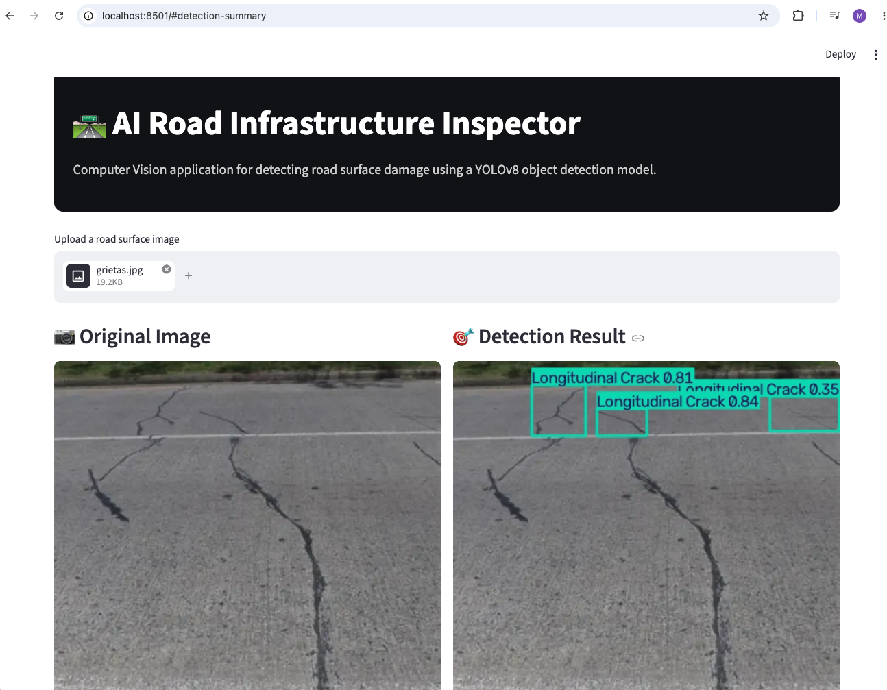
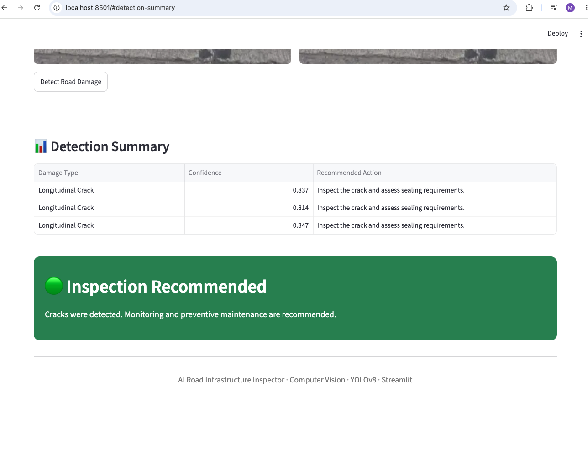

# AI Road Infrastructure Inspector

An end-to-end Computer Vision application for road surface damage detection using YOLOv8n, transfer learning, Streamlit and Docker, deployed on AWS EC2.

**[Open Application](http://52.56.100.94:8501)**

## Project Overview

Road surface defects can increase accident risk, vehicle damage and maintenance costs.

This application analyses uploaded road images to detect four types of damage, display bounding boxes and confidence scores, and provide maintenance recommendations.

The objective is to support road inspection and maintenance prioritisation.

## Application

### Image Inspection and Detection



### Detection Summary and Maintenance Recommendations



## Features

- Upload road images in JPG, JPEG or PNG format.
- Detect potholes and three types of pavement cracks.
- Compare the original image with the annotated detection result.
- Review detected objects, confidence scores and recommended actions.
- Display a maintenance priority based on the detected damage types.

## Dataset

**Road Damage Dataset**

Source: [Kaggle — Road Damage](https://www.kaggle.com/datasets/alvarobasily/road-damage)

The dataset contains **3,321 images** and **6,999 annotated objects**.

| Class | Annotated Objects |
|---|---:|
| Pothole | 2,657 |
| Alligator Crack | 964 |
| Lateral Crack | 1,222 |
| Longitudinal Crack | 2,156 |

### Dataset Split

| Split | Images |
|---|---:|
| Training | 2,324 |
| Validation | 498 |
| Test | 499 |

Images and their corresponding YOLO annotation files were split using `random_state=42`.

The full dataset is excluded from the repository.

## Project Structure

```text
UK-Road-Damage-Detection/
├── .github/
│   └── workflows/
│       └── ci.yml
├── app/
│   └── streamlit.py
├── data/
├── images/
│   ├── 1.png
│   └── 2.png
├── models/
│   └── best.pt
├── notebooks/
│   ├── 01_data_preparation.ipynb
│   ├── 02_model_training.ipynb
│   └── 03_model_evaluation.ipynb
├── .dockerignore
├── .gitignore
├── docker-compose.yml
├── Dockerfile
├── requirements.txt
└── README.md
```

## Workflow

### 1. Data Preparation

- Extract and inspect images and annotations.
- Verify image and annotation correspondence.
- Analyse class distribution.
- Visualise annotated bounding boxes.
- Create training, validation and test splits.
- Generate the YOLO dataset configuration.

### 2. Model Training

- Apply transfer learning using pretrained YOLOv8n weights.
- Compare training runs of 50 and 100 epochs.
- Use an image size of 640 pixels and batch size of 16.
- Select the best checkpoint from the 100-epoch experiment using validation performance.

### 3. Model Evaluation

Evaluate the selected model on the held-out test set and inspect example predictions.

### 4. Deployment

- Build the Streamlit application in PyCharm.
- Package the application with Docker and CPU-only PyTorch.
- Check Docker image builds through GitHub Actions.
- Deploy on AWS EC2 using Docker Compose.

## Model Performance

Results on **499 test images containing 1,048 annotated objects**:

| Metric | Score |
|---|---:|
| Precision | 0.672 |
| Recall | 0.558 |
| mAP@50 | 0.599 |
| mAP@50-95 | 0.278 |

### Performance by Class

| Class | Precision | Recall | mAP@50 | mAP@50-95 |
|---|---:|---:|---:|---:|
| Pothole | 0.730 | 0.667 | 0.708 | 0.335 |
| Alligator Crack | 0.693 | 0.643 | 0.645 | 0.299 |
| Lateral Crack | 0.570 | 0.364 | 0.428 | 0.154 |
| Longitudinal Crack | 0.696 | 0.557 | 0.614 | 0.325 |

The selected model weights are approximately **6.5 MB**.

## Technologies

- Python
- YOLOv8n
- Ultralytics
- PyTorch
- Pillow
- Streamlit
- Docker and Docker Compose
- GitHub Actions
- AWS EC2
- Google Colab

## Run Locally

Run these commands from the project root:

```bash
python -m pip install -r requirements.txt
python -m streamlit run app/streamlit.py
```

Open [http://localhost:8501](http://localhost:8501).

## Run with Docker

```bash
docker build -t uk-road-damage-detection .
docker run -p 8501:8501 uk-road-damage-detection
```

Alternatively, use Docker Compose:

```bash
docker compose up --build -d
```

## AWS Deployment

The application is deployed on an Ubuntu EC2 instance using Docker Compose.

After installing Docker, Git and Docker Compose on the instance:

```bash
git clone https://github.com/hmmazuera/UK-Road-Damage-Detection.git
cd UK-Road-Damage-Detection
sudo docker compose up --build -d
```

The application uses port **8501**.

## Continuous Integration

GitHub Actions builds the Docker image on pushes and pull requests targeting `main`.

Deployment updates are applied manually on EC2.

## Limitations

- The model can miss defects and produce incorrect detections.
- Lateral Crack has the lowest test recall.
- No detections does not confirm that a road is damage-free.
- Maintenance priorities are simple rules based on detected classes; they do not assess engineering severity or replace professional inspection.

## Author

Mauricio Mazuera

- [GitHub](https://github.com/hmmazuera)
- [LinkedIn](https://www.linkedin.com/in/mauricio-mazuera-a0a7a933b/)